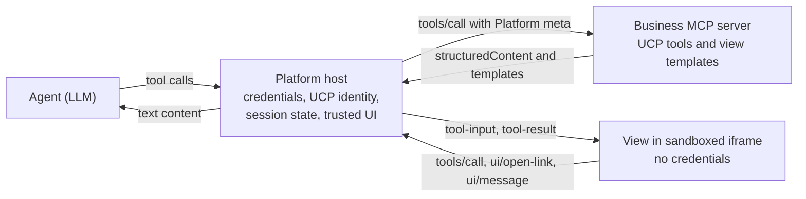
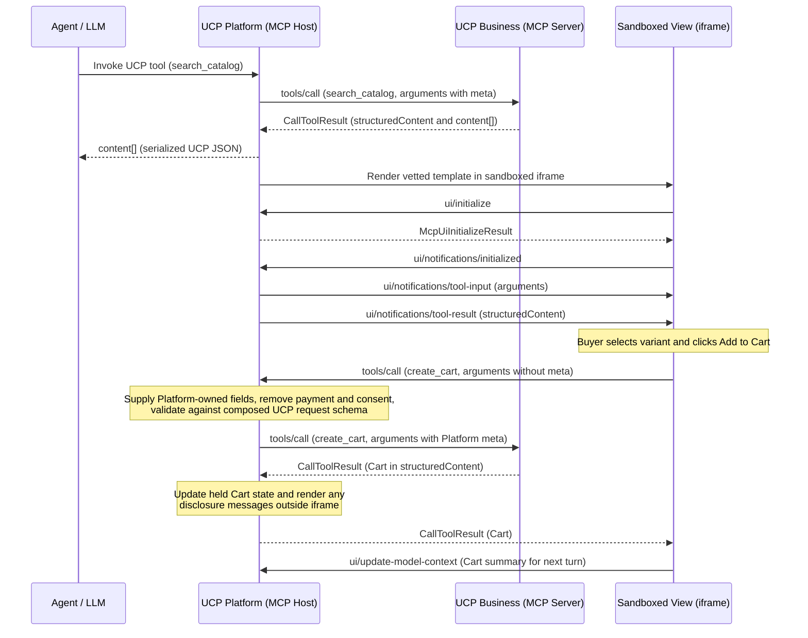

<!--
   Copyright 2026 UCP Authors

   Licensed under the Apache License, Version 2.0 (the "License");
   you may not use this file except in compliance with the License.
   You may obtain a copy of the License at

       http://www.apache.org/licenses/LICENSE-2.0

   Unless required by applicable law or agreed to in writing, software
   distributed under the License is distributed on an "AS IS" BASIS,
   WITHOUT WARRANTIES OR CONDITIONS OF ANY KIND, either express or implied.
   See the License for the specific language governing permissions and
   limitations under the License.
-->

# MCP Apps Integration

## Overview

[MCP Apps](https://modelcontextprotocol.io/extensions/apps/overview)
(`io.modelcontextprotocol/ui`, specification version `2026-01-26`) is a Model
Context Protocol extension that lets MCP servers attach interactive, sandboxed
HTML views (`ui://` resources with media type `text/html;profile=mcp-app`) to
MCP tools.

This document specifies how UCP Businesses (acting as MCP servers) and UCP
Platforms (acting as MCP Apps hosts) use MCP Apps alongside UCP's MCP transport
bindings.

In this document, a **view** is a `ui://` template that a Business's MCP server
serves and a Platform host renders. A view may be built by the Business, its
commerce platform, or an app developer. The Business is accountable for every
view its MCP server serves.

Four rules shape the integration:

1. **Standard UCP tools and schemas remain unchanged.** Adding an MCP Apps view
   decorates a UCP tool's `_meta.ui` metadata without changing the tool's name,
   `inputSchema`, `outputSchema`, or `structuredContent` payload.
2. **Static templates, dynamic `structuredContent`.** Every `ui://` resource is
   a static, data-agnostic HTML template that Platforms can prefetch, cache, or
   vet ahead of time. Runtime commerce data arrives via
   `ui/notifications/tool-result` in `structuredContent`.
3. **Host-mediated UCP operations.** Views perform UCP operations only by
   calling standard UCP MCP tools (`tools/call`) through the Platform host. The
   Platform enforces UCP capability negotiation, supplies Platform-owned
   request fields, and holds the authoritative session state.
4. **Views show and edit; the Platform confirms and pays.** A view may show
   and change what the Buyer is buying, from search through an open checkout
   or booking session. Only the Platform confirms the purchase with the Buyer,
   supplies payment, and completes it (see [Scope](#scope)).

MCP Apps is negotiated at the MCP protocol layer during `initialize` and does
not modify UCP JSON schemas or response payloads.

### Architecture



| Component | Role |
| :--- | :--- |
| **Platform host** | Holds the Buyer's credentials, the Platform's UCP identity, and the authoritative session state. Renders trusted UI, including disclosures and purchase confirmation. Mediates every request a view makes. |
| **View** | Renders the UCP response it is given inside a sandboxed iframe. Holds no credentials. Reaches the Business's MCP server only through the Platform host. |
| **Business MCP server** | Serves UCP tools and `ui://` templates. Receives every request under the Platform's identity. |

### Scope

A view may show and edit what the Buyer is buying. Only the Platform confirms
the purchase with the Buyer, supplies payment, and completes it.

The following rules classify every UCP operation, including operations of
capabilities and verticals defined after this document. They are applied in
order:

1. **Complete operations.** A transaction session is a resource whose
   capability defines a Complete operation (for example, a checkout or a
   booking session). Complete is **Platform-only**.
2. **Read-only operations.** An operation that does not change resource state
   (such as a search, a lookup, a get, or `ask`) is **view-capable**.
3. **Changes before completion.** An operation that creates or updates a cart,
   or that creates or updates an open transaction session, is view-capable.
   A session is open while its status still allows updates. For a checkout
   or booking session, that is `incomplete`, `requires_escalation`, or
   `ready_for_complete`.
4. **Other state-changing operations.** Any other state-changing operation,
   including one that cancels or deletes a resource or changes an order, is
   Platform-only unless its capability specification states that a view may
   call it.

A Business **MAY** attach a view to the tool of a view-capable operation, and
a view **MAY** call it.

A **Platform-only** operation is performed only by the Platform, through its
agent or its own UI, as the operation's capability specification allows. A
Business **MUST NOT** attach a view to its tool, and a view **MUST NOT** call
it.

The following table is informative. It shows how the rules classify the
operations defined when this document was written. The rules, not the table,
govern.

| Classification | Operations |
| :--- | :--- |
| View-capable | Catalog search, lookup, and get product; Ask; Location search and lookup; Create, Get, and Update Cart; Create, Get, and Update on a checkout or booking session; Get Order |
| Platform-only | Complete and Cancel on a checkout or booking session; Cancel Cart |

A Platform **MAY** decline to render any view and present the response in its
own UI instead, and **MAY** refuse any call a view makes (see
[Refused Calls and Fallbacks](#refused-calls-and-fallbacks)). For example, a
Platform may show its own checkout as soon as a session is created. Attaching
a view does not change a capability's own requirements on the Platform or the
Business.

### Relationship to the Embedded Protocol

MCP Apps and the [Embedded Protocol](embedded-protocol.md) serve distinct
integration patterns:

| Aspect | MCP Apps (`io.modelcontextprotocol/ui`) | Embedded Protocol (`embedded-protocol.md`) |
| :--- | :--- | :--- |
| **Where it runs** | View served by the Business's MCP server, rendered by the Platform host on a host-controlled sandbox origin | The Business's own checkout or cart web application, on the Business's origin |
| **Transport layer** | MCP transport only (`tools/list`, `resources/read`, `tools/call`) | Any UCP transport that returns a Checkout or Cart `continue_url` |
| **UI resource** | Static, data-agnostic `ui://` HTML template (`text/html;profile=mcp-app`) populated via `structuredContent` | Live per-session Business web application loaded from `continue_url` (`?ec_version=...` for Checkout, `?ep_version=...` for Cart) |
| **Scope** | Read-only operations, and changes to a cart or to an open checkout or booking session | Interactive Checkout and Cart sessions (`continue_url`) |
| **Credentials & completion** | No credentials in views; the Platform confirms and completes | Supports payment, address, and credential delegation (`ec.payment.*`, `ec.fulfillment.address_change_request`) and Business-hosted completion |

### Checkout and Payment Boundary

Two invariants hold for every view:

1. **No raw credentials.** A view **MUST NOT** collect payment credentials
   (such as card numbers or card security codes) or account authentication
   secrets.
2. **The Platform confirms and completes.** A view cannot complete a
   transaction session. The Platform completes it as the session's capability
   specifies: [Checkout](shopping/checkout/index.md), for example, requires
   the Buyer to review and place the order through a trusted UI unless the
   AP2 Mandates extension applies. When the Platform asks the Buyer to
   confirm, its confirmation **MUST** show what the Buyer is committing
   to, taken from the Platform's latest held state: what is being bought
   (such as the items or the stay), the total and any other amounts the
   capability requires the Buyer to see, and, where there is one, the
   fulfillment method and destination. If a view changes any of these
   after the Platform has shown the confirmation, the Platform **MUST**
   show it again before completing.

A view's requests travel under the Platform's identity, so the Platform
vouches for what it forwards. That is why payment, consent, and completion
stay with the Platform. It is also why the Platform, not the view, remains
responsible for a session's status, its messages, and any step that needs the
Buyer outside the view (such as escalation through `continue_url` or payment
authentication).

This revision does not let a view complete a transaction session or ask the
Platform to complete one. Two designs are left to a future revision:

* **A view asks the Platform to complete.** The Platform confirms with the
  Buyer and supplies payment. This makes Complete callable by views, which
  weakens the protection that tool visibility gives on MCP Apps hosts that
  are not UCP Platforms.
* **The Buyer confirms in the view with a payment method saved with the
  Business.** This needs a decision on whether a view can be the trusted UI
  that Checkout requires.

## Discovery and Negotiation

The Platform host, as the MCP client, advertises MCP Apps support in its MCP
`initialize` request via
`capabilities.extensions["io.modelcontextprotocol/ui"]`:

<!-- ucp:example skip reason="MCP initialize capability snippet, not a UCP payload" -->
```json
{
  "capabilities": {
    "extensions": {
      "io.modelcontextprotocol/ui": {
        "mimeTypes": [
          "text/html;profile=mcp-app"
        ]
      }
    }
  }
}
```

UCP capability negotiation proceeds independently using the Platform profile and
the Business discovery profile (`/.well-known/ucp`), as defined in the
[Specification Overview](overview/index.md#negotiation-protocol).

A view takes no part in UCP negotiation and is not told its result. The
Platform, which knows the negotiated capabilities, decides whether to forward
each call a view makes (see
[Refused Calls and Fallbacks](#refused-calls-and-fallbacks)).

## Tool Declarations and Static `ui://` Templates

### Tool Metadata (`_meta.ui`)

A Business **MAY** attach a view to the tool of a view-capable UCP operation
(see [Scope](#scope)) by setting `_meta.ui.resourceUri` in `tools/list`. A
Business **MUST NOT** change the UCP tool's name, `inputSchema`, or
`outputSchema` to do so.

MCP Apps treats a tool without `_meta.ui.visibility` as callable by both the
agent and views (`["model", "app"]`), and an MCP Apps host that is not a UCP
Platform enforces only that declaration. A Business whose MCP server declares
any view therefore:

* **MUST** set `visibility: ["model"]` (without `"app"`) on the tool of every
  Platform-only UCP operation.
* **MAY** choose the visibility of view-capable tools.
* **SHOULD** set the MCP tool annotation `readOnlyHint: true` on the tools of
  read-only UCP operations. MCP treats a tool without it as one that may
  change state, and a host may ask the user before running it.
* **MAY** expose helper tools to views (see [Helper Tools](#helper-tools)).

A Platform enforces the classification itself (see
[Platform Host Requirements](#platform-host-requirements)) and does not rely on
these declarations.

<!-- ucp:example skip reason="MCP tools/list definitions, not a UCP payload" -->
```json
{
  "tools": [
    {
      "name": "get_cart",
      "description": "Retrieve the current cart state.",
      "inputSchema": { ... },
      "outputSchema": { ... },
      "annotations": {
        "readOnlyHint": true
      },
      "_meta": {
        "ui": {
          "resourceUri": "ui://merchant.example/cart-view.html",
          "visibility": ["model", "app"]
        }
      }
    },
    {
      "name": "update_checkout",
      "description": "Update a checkout session.",
      "inputSchema": { ... },
      "outputSchema": { ... },
      "_meta": {
        "ui": {
          "resourceUri": "ui://merchant.example/checkout-view.html",
          "visibility": ["model", "app"]
        }
      }
    },
    {
      "name": "complete_checkout",
      "description": "Complete the checkout and place the order.",
      "inputSchema": { ... },
      "outputSchema": { ... },
      "_meta": {
        "ui": {
          "visibility": ["model"]
        }
      }
    },
    {
      "name": "get_size_guide",
      "description": "Return the size guide for a product.",
      "inputSchema": { ... },
      "annotations": {
        "readOnlyHint": true
      },
      "_meta": {
        "ui": {
          "visibility": ["app"]
        }
      }
    }
  ]
}
```

### Helper Tools

A helper tool is a tool on the Business's MCP server that is not a UCP
operation (for example, a tool that returns a size guide or product reviews).
A view calls a helper tool the same way it calls a UCP tool: through the
Platform host, which sees the name and arguments of every call. MCP Apps lets
a view call any tool on its server that is callable by views. This document
narrows that: a view **MAY** call a helper tool only when the tool:

* is served by the same MCP server as the view,
* is callable by views (its `_meta.ui.visibility` includes `"app"` or is
  omitted),
* declares the MCP tool annotation `readOnlyHint: true`, and
* does not create or change a UCP resource or place an order.

The Platform checks the first three conditions (see
[Platform Host Requirements](#platform-host-requirements)). It cannot check
the last one, or that the tool only reads. The Business is accountable for
both.

A view **MUST NOT** put payment credentials, account authentication secrets,
or Buyer details (see [Buyer Details in Views](#buyer-details-in-views)) in
the arguments of a helper tool. The Platform forwards helper tool arguments
unchanged, and **MAY** inspect them and refuse the call.

A Platform **MAY** refuse any helper tool, and a view **MUST** keep working
when a helper tool call is refused.

### Static `ui://` Resources

Every `ui://` resource referenced by a UCP tool **MUST** be a static,
data-agnostic HTML template with `mimeType: "text/html;profile=mcp-app"`. It
**MUST NOT** embed per-buyer, per-cart, or per-session data in the HTML asset
returned by `resources/read`. This is stricter than MCP Apps, which recommends
but does not require separating static templates from dynamic data.

* **Pre-registration and caching.** Because `ui://` templates are static, a
  Platform host **MAY** prefetch, cache, or require out-of-band registration
  and security vetting of `ui://` templates (along with their `_meta.ui.csp`
  and `_meta.ui.permissions` declarations) ahead of time, and serve its vetted
  copy at runtime, consistent with MCP Apps' allowance for hosts to prefetch
  and cache UI resources fetched via `resources/read`.
* **UCP operations go through the host.** A view **MUST NOT** send UCP requests
  directly to a UCP service endpoint. All UCP operations **MUST** flow through
  the Platform host via MCP `tools/call`.
* **Other requests are optional.** A Platform **MAY** decline to forward
  `resources/read` requests from views, and any other request from a view
  that this document does not define. A view **MUST** work without them.
* **Self-contained templates.** A template **SHOULD** bundle its scripts and
  styles in the HTML asset. It **SHOULD NOT** declare `connectDomains` or
  `frameDomains` in `_meta.ui.csp`, and **SHOULD** load only images, fonts,
  and media from the origins it declares in `resourceDomains`. A Platform
  may decline to grant network access, embedded pages, or scripts from other
  origins (see [Security Considerations](#security-considerations)), and a
  template that depends on scripts from other origins does not work on that
  Platform. A view **MUST** keep working without `connectDomains`, and gets
  data beyond UCP responses through [helper tools](#helper-tools).

<!-- ucp:example skip reason="MCP resources/read response, not a UCP payload" -->
```json
{
  "contents": [
    {
      "uri": "ui://merchant.example/cart-view.html",
      "mimeType": "text/html;profile=mcp-app",
      "text": "<!DOCTYPE html><html>...</html>",
      "_meta": {
        "ui": {
          "csp": {
            "connectDomains": [],
            "resourceDomains": ["https://cdn.merchant.example"]
          },
          "prefersBorder": true
        }
      }
    }
  ]
}
```

### Buyer Details in Views

A view **MAY** ask the Buyer for details that an operation needs and that the
response it was given does not contain (for example, a delivery address).
The following rules apply:

* **No credentials.** A view **MUST NOT** ask for payment credentials or
  account authentication secrets (see
  [Checkout and Payment Boundary](#checkout-and-payment-boundary)). Flows
  that need credential entry **MUST** use
  [Identity Linking](common/identity-linking/index.md), the
  [Embedded Protocol](embedded-protocol.md), or a `ui/open-link` to the
  Business's own page.
* **No consent or payment controls.** A view **SHOULD NOT** present controls
  for consent or for choosing a payment method. The Platform removes both
  from a view's requests and supplies them itself.
* **Through the UCP operation.** A view **MUST** send Buyer details that
  correspond to a UCP request field through the UCP operation, so that the
  Platform can apply its
  [requirements](#platform-host-requirements). A view **MUST NOT** send them
  to the Business by another path, such as a helper tool or a network
  request.
* **Show before asking.** A view **SHOULD** show Buyer details that are
  already in the response it was given rather than ask for them again.

A Platform **SHOULD** make clear to the Buyer that a view is provided by the
Business, and **MAY** set its own policy on what a view may collect.

## Runtime Lifecycle and Data Flow



The diagram shows one valid ordering. MCP Apps also permits a host to render
and initialize the view while tool execution is still in progress.

1. **Dual-output tool result.** A decorated UCP tool returns its result as
   defined by the [MCP transport binding](overview/index.md#response-format):
   the UCP response object in `structuredContent` and, per that binding, its
   serialized JSON representation in `content[]`.
2. **View initialization and data delivery.** Once the view sends
   `ui/initialize` and `ui/notifications/initialized`, the Platform host
   delivers the tool arguments via `ui/notifications/tool-input` and the UCP
   response via `ui/notifications/tool-result` (in `params.structuredContent`).
   The Platform **SHOULD** deliver the arguments as they were before it
   added its own members (`meta`, `context`, `signals`, and `attribution`).
   MCP Apps asks a host to send the complete tool arguments; those members
   are the Platform's own additions, and a view does not need them.
3. **Monetary amounts.** A view **MUST** display monetary amounts exactly as
   received in `structuredContent`, without recomputing them. The UCP response
   fields in `structuredContent` remain authoritative, and the Platform's own
   confirmation is the authoritative presentation before purchase.
4. **Disclosures.** The Platform **MUST** render `messages` with
   `presentation: "disclosure"` from every response it delivers to a view in
   Platform-owned UI outside the iframe, following the
   [disclosure rendering contract](shopping/checkout/index.md#disclosure), and
   **MUST** keep them in sync with the latest response for that resource.
5. **Stale views.** A view is stale when the Platform holds state for the
   resource the view displays that is newer than what the view has received
   and that did not result from the view's own calls. The Platform **MAY**
   disable state-changing calls from a stale view, and **MUST NOT** forward
   one without first obtaining Buyer confirmation in Platform-owned UI.
   Creating a transaction session needs no extra confirmation, because the
   Platform confirms the session with the Buyer before completing it. A
   Platform **MAY** replace a stale view with a fresh one. A view **SHOULD**
   render from the `structuredContent` of each result it receives rather than
   from state it keeps locally.
6. **Cancellation and teardown.** As required by MCP Apps, the Platform sends
   `ui/notifications/tool-cancelled` when an in-flight tool execution is
   cancelled, and sends the `ui/resource-teardown` request before tearing down
   a view. The Platform **MAY** tear the view down after a bounded wait if the
   view does not respond.

## View-Initiated Tool Calls and Platform Mediation

When a Buyer interacts with a control inside an MCP Apps view, the view
requests an operation by sending a JSON-RPC `tools/call` request to the
Platform host over `postMessage`.

### Platform Host Requirements

For every `tools/call` request a view sends, the Platform host **MUST**:

1. **Enforce scope.** Verify that the tool is served by the same MCP server as
   the view and is callable by views (its `_meta.ui.visibility` includes
   `"app"` or is omitted). For a UCP tool, verify that its capability is in
   the negotiated set and that its operation is view-capable (see
   [Scope](#scope)), and refuse every Platform-only operation regardless of
   its declared visibility. For any other tool, verify that it declares
   `readOnlyHint: true` (see [Helper Tools](#helper-tools)) and forward the
   arguments unchanged. The Platform refuses a call that fails these checks
   (see [Refused Calls and Fallbacks](#refused-calls-and-fallbacks)).
   Requirements 2 to 5 apply to UCP tools only.
2. **Supply Platform-owned fields.** Set `arguments.meta` with the Platform's
   own `ucp-agent` profile, ignoring any view-supplied `meta`, and strip or
   overwrite `context`, `signals`, and `attribution` (both at the top level of
   `arguments` and inside payload objects such as `cart` or `checkout`) using
   the Platform's own values. For a state-changing operation, the Platform
   **SHOULD** set an `idempotency-key` that it generates for each distinct
   Buyer action (reusing it only when the Platform itself retries that call),
   and **SHOULD** suppress duplicate requests from repeated gestures (such as
   a double click) while an identical earlier request is in flight.
3. **Remove payment and consent.** Remove any view-supplied `payment` member
   and any view-supplied consent state (such as `buyer.consent`). The Platform
   supplies both itself, and supplies consent only from decisions it captured
   from the Buyer.
4. **Control Buyer details.** Details about the Buyer, and about the people
   and places an order is for (such as `buyer`, a shipping destination, or
   `booker` on a booking session), flow through the Platform: a view sends
   them only in UCP requests (see
   [Buyer Details in Views](#buyer-details-in-views)). The Platform **MAY**
   add such details from its own records to a view's request, and **MAY**
   replace or remove any that a view supplies (for example, to keep a
   detail that it supplied or that the Buyer gave it outside the view). The
   Platform applies the capability's own rules to view-supplied details
   (such as which party assigns identifiers and when a detail may be sent).
5. **Validate arguments and resource ownership.** Validate the resulting
   `arguments` against the operation's composed UCP request schema. Any
   identifier of a cart, a transaction session, or an order in `arguments`
   (such as a cart `id` or `checkout.cart_id`) **MUST** match a resource the
   Platform holds for that Business in the current session.
6. **Handle the result.** A call succeeded only when the result is not a
   JSON-RPC error, does not set `isError`, and (for a UCP tool) does not carry
   `ucp.status: "error"` in `structuredContent`. After a successful UCP call
   and before returning the result to the view, the Platform updates its held
   state for the resource and brings Platform-rendered disclosures in sync
   with the response. An unsuccessful result **MUST NOT** replace held
   state, although the Platform stops holding a resource that the Business
   reports as gone (see [Cart and Session State](#cart-and-session-state)).
   For a transaction session, the Platform also acts on the session's status
   and messages as the capability specifies, whatever the view shows.
7. **Apply the interaction categories:**

| Category | Platform Host Behavior |
| :--- | :--- |
| Read-only operation | **MAY** forward on a Buyer gesture in the view. |
| Change to a cart or an open transaction session | **MAY** forward on a Buyer gesture in the view, subject to [Cart and Session State](#cart-and-session-state) and the stale view rule. |
| Helper tool | **MAY** forward unchanged. |
| Platform-only operation | **MUST** refuse. |
| UCP operation whose capability is unavailable to views | **MUST** refuse, and **SHOULD** let the Buyer continue another way (see [Refused Calls and Fallbacks](#refused-calls-and-fallbacks)). |

### Cart and Session State

The Platform holds the authoritative state of each cart and transaction
session. For changes that a view initiates, the Platform **MUST** ensure that:

* **Updates are built from held state.** Where an Update operation replaces
  the entire resource (as Update Cart and Update Checkout do), every
  view-initiated update is built from the Platform's latest held state, is
  valid against the request schema (response-only fields are not sent back),
  and keeps request fields that the view omitted (such as Buyer details and
  fields defined by negotiated extensions). A view sends each top-level
  member of the resource that it wants to change, with that member's
  complete new value. To clear a member, it sends an empty array or object
  of that member's type. A view cannot clear a member that holds a string,
  number, or boolean; it sends a new value instead.
* **Changes apply one at a time.** View-initiated changes to a resource are
  applied in order, each built from the result of the previous one.
* **There is one cart.** The Platform holds one cart for each Business in a
  session. When it already holds a cart for the Business, a view's Create
  Cart request does not create a second cart and does not drop existing
  lines. The Platform adds the requested items to its held cart and sends
  Update Cart instead.
* **Held resources are released.** The Platform stops holding a cart or
  session when a Cancel operation on it succeeds, when it has expired, or
  when the Business reports that it no longer exists (for example, with a
  `not_found` error). A view's next Create request is then forwarded as a
  Create. When the Platform learns this from the response to a view's
  Create request that it had sent as an Update, it **MAY** send that
  request again as a Create, with a new `idempotency-key` if it sets one.
* **A held cart follows its checkout.** A Business may reflect changes to a
  checkout back to the cart it was created from. Before it builds a cart
  update, the Platform refreshes a held cart whose checkout has changed
  since the cart was last read.

How the Platform combines items (for example, increasing the quantity of an
existing line or adding a new line) is its choice. After the Platform adds
items to an existing cart for a view that does not display that cart, it
**MUST** show the resulting change in Platform-owned UI and **SHOULD** let the
Buyer undo it.

### Refused Calls and Fallbacks

A view is not told which capabilities are negotiated, and this document
defines no UCP field in the MCP Apps host context. A view offers the actions
its template supports and calls the tool for the action the Buyer chose. The
Platform forwards the call or refuses it. A view **MUST NOT** conclude that a
capability is not negotiated because it is missing from `ucp.capabilities` in
`structuredContent`: a response lists only the capabilities relevant to its
own operation (see [Response Capability
Selection](overview/index.md#response-capability-selection)).

In Shopping:

* **Catalog to Cart or Checkout:** A catalog view calls `create_cart` (which
  the Platform adds to any held cart, as described in
  [Cart and Session State](#cart-and-session-state)). The catalog view of a
  Business that offers no Cart calls `create_checkout` with `line_items`.
* **Cart to Checkout:** A cart view calls `create_checkout` with
  `checkout.cart_id` set to the Cart `id`; it may omit `checkout.line_items`
  or send an empty array.

<!-- ucp:example schema=shopping/checkout op=create direction=request extract=$.params.arguments.checkout -->
```json
{
  "jsonrpc": "2.0",
  "id": 2,
  "method": "tools/call",
  "params": {
    "name": "create_checkout",
    "arguments": {
      "checkout": {
        "cart_id": "cart_abc123",
        "line_items": []
      }
    }
  }
}
```

After a view creates a transaction session, the Platform holds the session.
The Platform **MAY** continue in its own UI, or let views show and edit the
session until the Buyer is ready to confirm.

**Refusal.** When the Platform refuses a view's `tools/call` request, it
**MUST** answer the request with a JSON-RPC error whose `code` is `-32000`
and whose `data` object has the members below. A view relies on `data.code`,
not on the JSON-RPC error code.

The Platform answers in this way every `tools/call` request from a view that
it does not forward. That includes a request it declines under the stale
view rule, a request whose arguments fail validation, and a duplicate that
it suppresses.

| Member | Required | Description |
| :--- | :--- | :--- |
| `code` | Yes | `capability_unavailable` when the tool's capability is not negotiated, or the Platform does not let views use it. `not_permitted` for any other refusal (for example, a Platform-only operation, a tool that does not meet the helper tool conditions, or Platform policy). |
| `handled` | Yes | `true` when the Platform has taken over the Buyer's action: it opened a link, continued in its own UI, told the Buyer the outcome, or is already carrying the action out through an earlier request. Otherwise `false`. |
| `content` | No | Human-readable text. |

<!-- ucp:example schema=transports/jsonrpc def=error_response -->
```json
{
  "jsonrpc": "2.0",
  "id": 4,
  "error": {
    "code": -32000,
    "message": "Operation not available to this view",
    "data": {
      "code": "capability_unavailable",
      "content": "Cart is not available. The product page was opened instead.",
      "handled": true
    }
  }
}
```

When `handled` is `true`, a view **MUST NOT** open a link or send the request
again for the same Buyer action. When it is `false` and the Buyer took the
action, the view **SHOULD** tell the Buyer that the action is not available,
and **MAY** offer another action its template supports.

**Platform fallback.** When the Platform refuses a call with
`capability_unavailable`, it **SHOULD** let the Buyer continue another way,
when it can, without passing control back to the view. It may use another
negotiated operation or its own UI (for example, starting a checkout from
the same items when Cart is not negotiated and Checkout is). Or it may take
the Buyer to a URL for the same purpose, when it holds one:

* For a request that carries `line_items` and no cart (such as `create_cart`,
  or `create_checkout` from a catalog view): a [Permalink](permalink.md) URL
  built from those items when Permalink is negotiated, or else the product or
  variant `url` from a response the Platform delivered to the view.
* For `create_checkout` with a `cart_id`: the `continue_url` of the held
  Cart.

These URLs are optional in UCP responses. A view can send requests on its
own, so the Platform **MAY** ask the Buyer before it opens a URL. When the
Platform cannot let the Buyer continue, it tells the Buyer in its own UI
that the action is not available. In each of these cases the Platform has
taken over the action and sets `handled` to `true`.

**Errors without `handled`.** A failed call whose error has no
`data.handled` member was not refused under this section. It comes from an
MCP Apps host that does not implement this document, or it is an error from
the Business that the Platform relayed. A view **MAY** then open a URL for
the same purpose from the response it holds, via `ui/open-link`.

## Worked Example: Cart and Checkout Across Views

This section is informative. It follows one Shopping session in which Cart and
Checkout are negotiated and the Platform holds no cart at the start.

1. **First add.** The Buyer clicks Add to Cart in catalog view A. The view
   sends a Create Cart request without `meta`:

    <!-- ucp:example schema=shopping/cart op=create direction=request extract=$.params.arguments.cart -->
    ```json
    {
      "jsonrpc": "2.0",
      "id": 4,
      "method": "tools/call",
      "params": {
        "name": "create_cart",
        "arguments": {
          "cart": {
            "line_items": [
              { "item": { "id": "sku_a" }, "quantity": 1 }
            ]
          }
        }
      }
    }
    ```

    The Platform holds no cart, so it adds its own `meta` and forwards the
    request. The Business returns cart `cart_abc123` with one line, `li_1`.
    The Platform stores it as the held Cart and returns the result to view A.

2. **Second add, from another view.** The Buyer runs a new search and clicks
   Add to Cart on a different product in catalog view B. View B sends the same
   kind of Create Cart request for `sku_b`. The Platform already holds
   `cart_abc123`, so instead of creating a second cart it builds an Update Cart
   request from its held Cart and adds the new item:

    <!-- ucp:example schema=shopping/cart op=update direction=request extract=$.params.arguments.cart -->
    ```json
    {
      "jsonrpc": "2.0",
      "id": 12,
      "method": "tools/call",
      "params": {
        "name": "update_cart",
        "arguments": {
          "meta": {
            "ucp-agent": {
              "profile": "https://platform.example/profiles/shopping-agent.json"
            },
            "idempotency-key": "8f14e45f-ceea-467f-a8f1-8b2c3c1d9a10"
          },
          "id": "cart_abc123",
          "cart": {
            "line_items": [
              { "id": "li_1", "item": { "id": "sku_a" }, "quantity": 1 },
              { "item": { "id": "sku_b" }, "quantity": 1 }
            ]
          }
        }
      }
    }
    ```

    The Platform stores the returned Cart, returns the result to view B, and
    shows the added item in its own UI with a way to undo it.

3. **The agent changes the cart while a cart view is open.** The Buyer asks to
   see the cart, and the Platform renders cart view C from a Get Cart
   response. The Buyer then asks the agent for two of the first item. The
   agent's Update Cart call succeeds, and the Platform now holds a Cart with
   two of `sku_a` and one of `sku_b`. View C still shows one of each, and the
   newer state did not come from view C, so view C is stale.

4. **A click in the stale view.** The Buyer clicks Remove on `sku_b` in view
   C, which sends an Update Cart request built from its old snapshot. The
   Platform does not forward it. It shows the Buyer the current cart and the
   requested change in its own UI, and forwards an update only if the Buyer
   confirms. If the Buyer declines, the Platform answers view C's request
   with a refusal. The Platform could instead have replaced view C with a
   fresh view as soon as the cart changed.

5. **Checkout in a view.** The Buyer clicks Checkout in the current cart
   view. The view calls `create_checkout` with `checkout.cart_id` set to
   `cart_abc123`. The Platform adds its own fields and the contact details
   and shipping address it has saved for the Buyer, forwards the request,
   and holds the returned Checkout, `chk_123`. The view now shows the
   checkout. Had the Platform saved no address, the Checkout would come back
   without one. The Platform could then ask the Buyer in its own UI, or the
   view could show an address form and send the address in an Update
   Checkout request, which the Platform handles like any other request from
   a view. Here the Buyer raises a quantity, and the view sends an Update
   Checkout request with only what it changes:

    <!-- ucp:example schema=shopping/checkout op=update direction=request extract=$.params.arguments.checkout -->
    ```json
    {
      "jsonrpc": "2.0",
      "id": 15,
      "method": "tools/call",
      "params": {
        "name": "update_checkout",
        "arguments": {
          "id": "chk_123",
          "checkout": {
            "line_items": [
              { "id": "li_1", "item": { "id": "sku_a" }, "quantity": 3 },
              { "id": "li_2", "item": { "id": "sku_b" }, "quantity": 1 }
            ]
          }
        }
      }
    }
    ```

    The Platform builds the full update from its held Checkout, keeping the
    Buyer details and address it supplied, and returns the result to the view.

6. **Confirmation and completion.** When the Buyer is ready, the Platform
   shows its own confirmation, with the items, the total, and the shipping
   method and address from its latest held Checkout. The Buyer confirms
   there, and the Platform sends
   Complete Checkout with the payment it holds. The view takes no part in
   this step.

## Model Context Synchronization and External Links

* **Keeping the agent in sync (`ui/update-model-context`).** After a view
  updates state (for example, after `create_cart` or `update_cart` succeeds, or
  when the Buyer selects product options in the view), the view **SHOULD** call
  `ui/update-model-context` with a concise structured summary (such as the
  active `cart_id`, line item count, and total) so subsequent conversational
  turns have accurate context without re-fetching.
* **Content from views (`ui/update-model-context`, `ui/message`).** Content
  that a view sends via `ui/update-model-context` or `ui/message` comes from
  the view, not from the Buyer, even though MCP Apps gives `ui/message` the
  `user` role. The Platform **MUST** attribute such content to the Business
  and **MUST NOT** treat it as Buyer consent or as a Buyer instruction to
  perform a state-changing operation.
* **External links (`ui/open-link`).** The Platform **MUST** reject a
  `ui/open-link` request whose URL is not an `https` URL. The Platform
  **SHOULD** also limit the URL to one that appears in a UCP response delivered
  to that view, shares the origin of the Business's discovery profile or
  service endpoint, or is the negotiated Permalink `config.endpoint` or a
  path under it.

## Security Considerations

* **Sandboxed execution.** The Platform host **MUST** render `ui://` templates
  in a sandboxed iframe as required by MCP Apps (for web hosts, on an origin
  distinct from the Platform host), enforcing the resource's `_meta.ui.csp`
  policy and granting only approved `_meta.ui.permissions`.
* **Network access and scripts.** By default, MCP Apps gives a view no network
  access and only the scripts in its own template, and lets a host apply a
  stricter policy than a template declares. The Platform **SHOULD NOT** grant
  `connectDomains` (network requests from the view) or `frameDomains` (other
  pages embedded in the view), and **SHOULD NOT** allow scripts from
  `resourceDomains`. The Platform cannot see requests that a view makes
  directly, and a script loaded at run time can change after the template
  was vetted. A Platform that grants any of these **SHOULD** grant it only
  to templates and origins it has vetted.
* **No credentials in views.** The Platform **MUST NOT** pass Buyer or Platform
  credentials (such as access tokens or payment credentials) into a view,
  whether in `hostContext`, in tool arguments, or in any other message.
* **Platform-owned disclosures and purchase confirmation.** The Platform
  **MUST** render UCP `messages` with `presentation: "disclosure"` in
  Platform-owned UI outside the iframe so a view cannot obscure or suppress
  required disclosures, and **MUST NOT** let a view replace the Platform's own
  purchase confirmation.
* **What the Platform cannot see.** The Platform does not see what a view
  renders, or what a view sends to origins the Platform allowed in its
  content security policy. That includes origins allowed only for images
  and other static resources, because the URL of such a request can carry
  data. The Platform's mediation covers only what a view sends through the
  host, so whatever the Buyer enters in a view can reach the Business.
* **Buyer gestures cannot be verified.** A request from a view carries no
  proof that the Buyer clicked anything, so a view can send requests on its
  own. The Platform's mediation, not the gesture, is what protects the Buyer.
  A Platform **MAY** rate-limit a view or ask the Buyer to confirm in its own
  UI. When a Platform adds the Buyer's saved details to a view's request is
  the Platform's policy. A Platform that adds them to a request a view sent
  on its own shares them with the Business and with its view.
* **One server per view.** A view can reach only the MCP server that served
  it. When a Business exposes UCP services on separate MCP endpoints, a view
  served by one cannot call tools on another.
