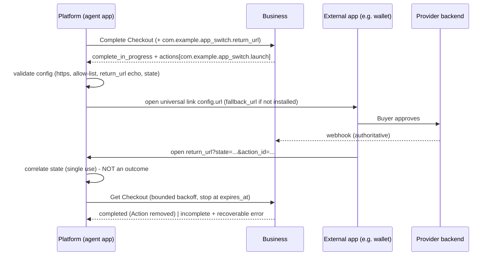

# Sample: App Switch Action (deep link launch + await return)

> **Non-normative sample.** Declares a vendor Action type,
> `com.example.app_switch.launch`, under the common
> [Overview — Actions](../../docs/specification/overview/index.md#actions) contract
> and the [Checkout — Actions](../../docs/specification/shopping/checkout/index.md#actions)
> lifecycle. Nothing here is part of UCP; it shows how an extension could add the
> "machinery" the common contract intentionally leaves out (URL scheme, callback,
> timeout, fallback).

Files:

- `app_switch.json` - extension schema (`allOf` composition onto Checkout).
- `demo.py` - stdlib-only simulation of Business + Platform. Run
  `python3 demo.py --scenario {happy,not_installed,timeout,forged_return}`.

## Why an extension

The common contract defines only `id` + `config` and says it defines "no URL
scheme, origin, or delegate policy ... no callback, result, state, polling, or
executor". An app switch needs all of those, so the declaring extension owns
them, exactly as the Payment Authentication extension does for 3DS.

## Flow



## Request: return target (extension field)

Actions are response-only, and Update Checkout is unavailable during
`complete_in_progress`, so the Platform supplies its return target **with**
Complete Checkout (or an earlier Update):

```json
{ "com.example.app_switch": { "return_url": "https://agent.example.com/ucp/return" } }
```

If it is missing, the Business returns `incomplete` with a `recoverable` error
rather than emitting an Action the Platform cannot finish.

## Response: the Action

```json
{
  "status": "complete_in_progress",
  "actions": {
    "com.example.app_switch.launch": [
      {
        "id": "app-switch-1",
        "config": {
          "url": "https://wallet.example.com/approve?session=ps_789&state=Q2...",
          "fallback_url": "https://wallet.example.com/web/approve?session=ps_789",
          "state": "Q2hlY2tvdXQtYXBwLXN3aXRjaA",
          "return_url": "https://agent.example.com/ucp/return",
          "app_hint": { "name": "Example Wallet", "ios_bundle_id": "com.example.wallet" },
          "timeout_seconds": 300
        }
      }
    ]
  },
  "messages": [
    { "type": "info", "code": "app_approval_required",
      "content": "Approve the payment in Example Wallet.",
      "path": "$.actions['com.example.app_switch.launch'][0]" }
  ]
}
```

| Field | Req | Notes |
| :-- | :-: | :-- |
| `url` | yes | Deep link to launch. SHOULD be an HTTPS universal link / app link (OS-verified domain ownership). Custom schemes only if Platform policy allows. |
| `fallback_url` | no | HTTPS web surface if no app claims `url`. |
| `state` | yes | Opaque, unguessable, single-use correlation value echoed on return. |
| `return_url` | yes | Echo of the Platform-supplied value; Platform MUST verify equality. |
| `app_hint` | no | Display-only. Never used for trust decisions. |
| `timeout_seconds` | no | Outer await deadline from launch, capped by `expires_at`. |

## Platform rules (sample contract)

1. Validate `url`/`fallback_url` against Platform policy (HTTPS, allow-listed
   origins tied to the negotiated handler), `return_url` equality, and `state`.
   Per the common contract, process no other field as a launch instruction.
2. Launch via the OS (universal link / app link only); on refusal use
   `fallback_url`; if neither works, follow Checkout fallback -> `continue_url`.
3. On return, accept only a link whose `state` matches a pending Action; consume
   it once. The return is **not** an outcome; it only means "observe now".
4. Get Checkout with bounded backoff until the Action is removed or status
   changes. Never infer success from the return or the external app.
5. If the same type + `id` is still outstanding after processing, do **not**
   relaunch (no safe-retry defined); hand off via `continue_url`. Do not Cancel
   while handoff can continue.
6. If no return arrives by the deadline, treat as abandoned but still Get
   Checkout - the provider may have completed out of band.

## Business rules (sample contract)

- Emit only when `com.example.app_switch` is negotiated and a `return_url` was
  supplied; keep the same `id` while the work is outstanding; new `id` for
  replacement work.
- Decide the outcome from server-side provider state (webhook), never from the
  return link.

## Things a real proposal would need to settle

- Whether `return_url` belongs in the request (as here) or in the Platform
  profile during negotiation.
- Whether the return signal should be authenticated (e.g. signed `state`) or
  remain a pure "wake up and observe" hint (this sample: hint only).
- Agent surfaces with no app to return to (headless / voice): rely on
  `continue_url` handoff or push-notification return.
- Generic vs. payment-scoped type (`dev.ucp.common.app_switch` vs. a payment
  handler Action), given 3DS already allows system-browser handoff only with an
  authenticated completion channel.
